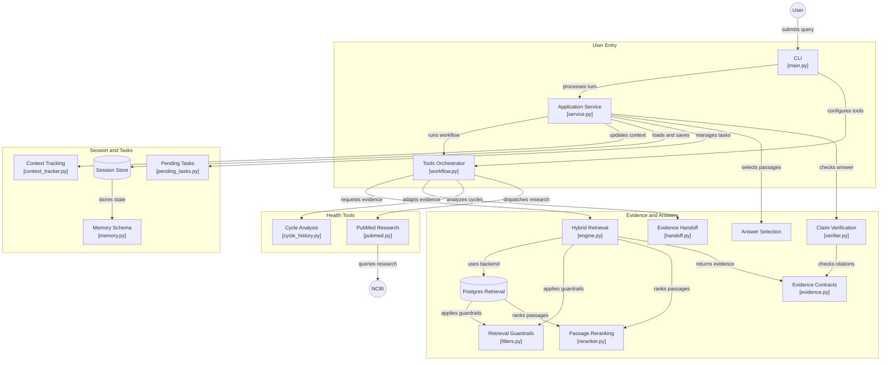

# Women's Health AI Agent 🌸

[](https://www.python.org/)
[](https://github.com/pgvector/pgvector)
[](https://redis.io/)
This is a **development education assistant** for adult PCOS and menstrual-health questions, cycle arithmetic, and explicitly authorized PubMed research.

The checked-in evidence registry contains unverified summaries. Strict mode excludes
these records by default; it will abstain until approved evidence is available.
Source approval, reuse rights, and clinical safety have not been established by
passing software tests. See [the provenance audit](docs/EVIDENCE_PROVENANCE_AUDIT.md).

- Answers use selected stored passages with source identifiers. These passages
  are not necessarily verbatim quotations from the linked publications.
- Claim verification uses token/rule checks; it is not proof of factual accuracy.
- CLI session retention is opt-in with `--remember`. Redis and PostgreSQL adapters
  are optional. Database failures produce controlled responses rather than a
  guarantee of uninterrupted service or deletion.

---

## 💬 What Questions Does It Answer?

The implemented development workflows cover these areas:

1. **Polycystic Ovary Syndrome (PCOS):**
   * Clear explanations of what PCOS is and how it affects reproductive hormones.
   * Commonly recognized symptoms (irregular cycles, hirsutism, persistent acne, insulin resistance).
   * Evidence-based lifestyle habits, physical activity, and dietary patterns for symptom support.

2. **Menstrual Health & Cycle Variations:**
   * Normal menstrual physiology, phases, and expected cycle ranges (21 to 35 days).
   * Painful periods and menstrual cramps (**Dysmenorrhea**): causes, non-pharmacological comfort measures, and when to seek medical evaluation.
   * Heavy menstrual bleeding (**Menorrhagia**): definitions, warning signs, and iron nutrition support.

3. **Menstrual Cycle Interval Arithmetic (Calculator Tool):**
   * Calculates exact intervals, average cycle length, and variation between consecutive period start dates supplied by the user.

4. **Scientific Research (PubMed Explorer):**
   * Searches the official NCBI PubMed repository for peer-reviewed studies when scientific literature is explicitly requested.

---

## 🛡️ What Does It NOT Do? (Safety Guardrails)

The software applies prototype safety/scope checks before retrieval. These rules are not clinically validated or a statement of regulatory compliance:

* ❌ **No Individual Medical Diagnoses:** The agent educates; it does not replace a doctor.
* ❌ **No Medication Prescriptions or Dosing Adjustments:** Requests to start, stop, or change doses of prescription drugs (Metformin, Spironolactone, Birth Control, etc.) are strictly blocked and referred to a prescribing clinician or pharmacist.
* ❌ **No Emergency Contraception Prescribing:** Queries regarding emergency contraceptive pills (e.g., *i-pill*, *Plan B*, *levonorgestrel*) are safely declared outside the educational corpus.
* ❌ **Immediate Emergency Escalation:** Red-flag symptoms (such as soaking through $\ge$ 2 pads an hour, sudden fainting, severe acute pelvic pain, or pregnancy complications) immediately trigger emergency triage guidance, bypassing all tools and retrieval.
* ❌ **Adults Only (18+):** Adolescent physiology differs significantly; questions from users under 18 are automatically routed to pediatric care.

---

## 🏛️ System Architecture Diagram

The system connects user interactions, safety filters, database adapters, and fact verification in a clean, self-healing pipeline:



---

## ⚡ Key Technical Innovations

1. **Dual Trust-Domain Isolation:**
   * **Ephemeral Patient Memory:** Conversation state is maintained in Redis with native TTL expiration (default 30 min) and TriState context (`yes`, `no`, `not_provided`).
   * **Governed Clinical Registry:** Stored in PostgreSQL with `pgvector` and mirrored locally in `manifest.json`. Sources are stamped with cryptographic SHA-256 fingerprints.

2. **PostgreSQL + pgvector Hybrid Search:**
   * Blends native full-text search (`ts_rank_cd`) with vector cosine similarity (`<=>`), filtered by relevance thresholding (PostgreSQL default `0.12`), jurisdiction, population, and expiry rules.
   * Punctuation-safe token grammar protects against SQL injection or full-text syntax crashes.

3. **Automated Claim Verification Gate:**
   * Candidate responses are inspected by `ClaimVerifier`. Any answer with unsupported statements or citation mismatches is replaced with a safe abstention fallback.

4. **Self-Healing Infrastructure:**
   * Auto-detecting factories (`get_session_store` and `get_retrieval_engine`) automatically connect to live PostgreSQL and Redis services when running, and gracefully fall back to local in-memory engines at initialization when optional services are unavailable. Runtime failures stop the affected request; they do not silently copy persistent sessions into another backend.

---

## 🚀 Quick Start Guide

### 1. Prerequisites & Environment Setup
Clone the repository and activate the virtual environment:

```powershell
# In PowerShell (Windows)
.\venv\Scripts\Activate.ps1
```

*(Or use `.\venv\Scripts\python.exe` directly)*.

### 2. Run the Interactive Assistant
Start the interactive conversational CLI with memory enabled:
```powershell
python main.py --remember --development-evidence
```
* Commands available in interactive chat:
  * `/forget`: Wipes your conversation context immediately.
  * `/cancel`: Clears any pending date calculation.
  * `/quit`: Cleanly exits the assistant.

### 3. Ask Specific Questions via Terminal
```powershell
# Medical evidence inquiry
python main.py --query "What is PCOS and what are its symptoms?" --development-evidence

# Emergency red-flag safety check
python main.py --query "I am pregnant, bleeding heavily and about to faint"

# Calculate cycle intervals
python main.py --query "Calculate my cycle intervals" --period-starts 2026-08-01 2026-09-05 2026-10-08 --as-of 2026-11-06

# Structured JSON output (API integration mode)
python main.py --query "What is PCOS?" --json --development-evidence
```

---

## 🧪 Testing & Quality Assurance

The codebase includes software regression tests and 50 supplied development scenarios. Fixture-backed checks require explicit development authorization:

```powershell
# Run unit and integration tests; live database suites require explicit test URLs
python -m unittest discover -s tests -v

# Run the 50-case software suite with unverified fixtures (not clinical validation)
python -m evals.run_evals --development-evidence
```

### Evidence and backend modes

`--development-evidence` is for software demonstrations only; without it the CLI
excludes the unverified manifest. Library callers may explicitly set
`allow_unverified_for_development=True` or the `ALLOW_UNVERIFIED_EVIDENCE` environment
variable. Defaults are strict across local and database backends.

Live tests do not use `DATABASE_URL` or `REDIS_URL`. Set `TEST_DATABASE_URL` to a
test administrative PostgreSQL connection (permission to create/drop a disposable
database) and `TEST_REDIS_URL` to a test Redis connection. PostgreSQL tests create
an owned temporary database; Redis tests use unique prefixed keys. Missing test
URLs are reported as skips, not passes. A configured but broken service fails.

See [the November 10 code review](docs/REVIEW_2026-11-10.md) for fixes and test limits.

---

## 📂 Repository Structure

```text
├── app/
│   ├── retrieval/             # Hybrid search, PostgreSQL pgvector engine, filters, reranker
│   ├── schemas/               # Canonical Pydantic models (evidence, citations, session memory)
│   ├── storage/               # Redis session store, in-memory store, TriState context tracker
│   ├── verification/          # ClaimVerifier & citation integrity validation
│   └── workflow/              # HealthApplication service & task stores
├── clinical/
│   └── evidence_manifest/     # Versioned clinical evidence manifest (manifest.json)
├── docs/                      # Engineering contracts, orchestration guide, consistency specs
├── evals/                     # 50-case seed benchmark suite & scoring rubrics
├── health_tools/              # Cycle history arithmetic, PubMed search, focused answer selection
├── infra/                     # Docker Compose file for PostgreSQL + pgvector and Redis
├── pipelines/                 # Manifest synchronization and database migration tools
├── tests/                     # Unit, integration, and opt-in live database suites
├── main.py                    # Main application CLI entry point
├── tools.py                   # Guardrailed educational search tools
└── REQUIREMENTS.txt           # Project dependencies
```

---

## ⚠️ Clinical Disclaimer

> **Important:** This assistant provides general educational information on menstrual health and PCOS for adults (18+) and cannot establish an individual medical diagnosis, interpret personal laboratory results, or direct medication changes. Software test results do not establish medical accuracy or clinical approval. Always consult a qualified healthcare professional for persistent, severe, or concerning symptoms.
