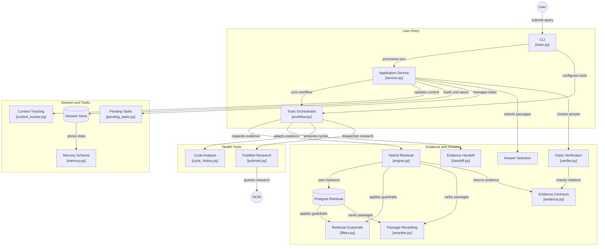

# Women's Health AI Agent

An evidence-grounded women's health education assistant for adult menstrual health and PCOS. This is a development build; source-review metadata and safety rules require independent clinical verification.

## Integrated tools workflow

The CLI now connects session context and hybrid evidence retrieval to cycle
calculations, explicitly authorized PubMed research, and citation-based output.
Session retention is off by default in the CLI; use `--remember` to opt in.
No API key or model call is needed for local evidence and calculations.

```bash
python3 main.py --query "What is PCOS and what are its symptoms?"
python3 main.py --query "What are PCOS symptoms?"
python3 main.py --query "Calculate my cycle intervals" --period-starts 2026-08-01 2026-09-05 2026-10-08 --as-of 2026-11-06
python3 main.py --query "Find PCOS research" --allow-external-research --research-query "PCOS systematic review"
python3 main.py --remember
python3 -m unittest discover -s tests -v
```

In interactive mode use `/quit` to exit, `/forget` to delete the active session,
or `/cancel` to clear a pending cycle calculation. With `--remember`, ask to
calculate cycle intervals, send ISO start dates and a reference date over replies,
then confirm the proposed inputs before calculation. See
[the pending-task contract](docs/PENDING_TASK_CONTRACT.md).
Use `--json` for the structured response. External research sends only the
separately provided research query to NCBI; exclude personal details.
See [the orchestration guide](docs/ORCHESTRATION.md) and
[the shared team contract](docs/TEAM_CONTRACT.md) for ownership and integration.
The standalone `workflow_demo` commands remain synthetic demonstrations.

Answers now select the requested sections rather than displaying the whole
retrieval bundle. Missing sections are identified explicitly. Follow-ups such as
`What about exercise?` use the active topic only when session context is available.


## System Architecture Diagram



## Implementation Plan and Team Diagrams

See the [implementation plan](docs/IMPLEMENTATION_PLAN.md) for the architecture, clinical safety workflow, evidence lifecycle, validation gates, roadmap, and first-sprint backlog. For an offline shareable version with eight rendered diagrams, open [the HTML handoff](docs/IMPLEMENTATION_PLAN.html) in a browser.

## Clinical Evidence Base (`clinical/evidence_manifest/`)

The manifest contains unverified development summaries, not clinically approved passages. Default retrieval excludes them. See the [provenance audit](docs/EVIDENCE_PROVENANCE_AUDIT.md) before any source is considered for approval.
The legacy records reference Monash, WHO, NICHD, ACOG, and CDC pages. Their stored
text, dates, locators, reviewer details, hashes, and reuse rights require review.

---

## Core Architecture: Memory & Retrieval

The system enforces two strictly isolated trust domains:

1. **Clinical Evidence & Hybrid Retrieval Engine (`app/retrieval/`, `clinical/evidence_manifest/`)**
   - **PostgreSQL + pgvector (`app/retrieval/pg_vector_engine.py`)**: Production-grade hybrid search combining PostgreSQL full-text search and `pgvector` cosine similarity, filtered by explicit approval, non-supersession, expiry, population, jurisdiction, topic anchors, and calibrated score threshold.
   - **In-Memory Fallback (`app/retrieval/engine.py`, `app/retrieval/reranker.py`)**: Local hybrid search over `manifest.json` with identical eligibility and topic-anchor rules. Expiry is inclusive on the date in both backends.
   - **Pre-Filtering & Guardrails (`app/retrieval/filters.py`)**: Scopes searches to definitions ("what it is"), symptoms, and lifestyle prevention—blocking prescriptions, medication dosing, and prompt injection attempts.
   - **Offline Discovery & Database Sync (`pipelines/seed_evidence.py`, `pipelines/sync_to_postgres.py`)**: Stages candidates into review queues and synchronizes approved manifests into PostgreSQL.

2. **Ephemeral Patient Session Memory (`app/storage/`, `app/schemas/memory.py`)**
   - **Redis Store (`app/storage/redis_session_store.py`)**: Ephemeral session memory with Redis key TTL (default 30 minutes), logical expiry checks, and explicit deletion.
   - **In-Memory Store (`app/storage/session_store.py`)**: Zero-dependency in-memory session store fallback.
   - **TriState Context Tracking (`app/storage/context_tracker.py`)**: Uses explicit `TriState` (`yes`, `no`, `not_provided`) so missing pregnancy status, medication use, or age never silently become negative findings.
   - **Clarification Turn Cap**: Enforces a maximum of **2 focused clarification turns**.

3. **Claim-to-Passage Checks (`app/verification/`)**
   - **Citation and Token Checks (`app/verification/verifier.py`)**: Uses token overlap and rules; this does not establish semantic entailment or clinical correctness.
   - **Final Answer Gate (`app/workflow/service.py`)**: Every excerpt claim must pass before display. Partial repairs, rejected claims, or verifier errors replace the whole answer with an abstention; unsupported display text is not retained.

---

## Infrastructure (PostgreSQL + pgvector & Redis)

Start the production-grade database services with Docker:
```bash
docker compose -f infra/docker-compose.yml up -d
```
Populate the PostgreSQL database from the clinical evidence manifest:
```bash
python pipelines/sync_to_postgres.py
```

---

## Repository Structure

```text
├── app/
│   ├── retrieval/
│   │   ├── engine.py          # HybridRetrievalEngine & GuardrailedEducationalSearch
│   │   ├── pg_vector_engine.py# PostgreSQL + pgvector Hybrid Engine
│   │   ├── filters.py         # Pre-retrieval hazard detection, scope guardrails & source eligibility
│   │   ├── reranker.py        # Hybrid lexical + vector scoring & bounded excerpt selection
│   │   └── exceptions.py      # UrgentEscalationRequired, ScopeViolationError, InsufficientEvidenceError
│   ├── schemas/
│   │   ├── evidence.py        # SourceMetadata, EvidencePassage, EducationalResponse
│   │   └── memory.py          # TriState, MinimalPatientContext, SessionMemory
│   ├── storage/
│   │   ├── consent.py         # ConsentPolicy & TTL rules
│   │   ├── context_tracker.py # Safe TriState context extraction & 2-turn clarification cap
│   │   ├── session_store.py   # EphemeralSessionStore with TTL & deletion cascades
│   │   └── redis_session_store.py # RedisSessionStore with native SETEX TTL
│   └── verification/
│       └── verifier.py        # ClaimVerifier, entailment checks & high-risk extrapolation filters
├── clinical/
│   └── evidence_manifest/
<<<<<<< HEAD
│       └── manifest.json      # Versioned, unverified development passages
=======
│       └── manifest.json      # Development evidence manifest; review metadata unverified
>>>>>>> origin/tools
├── docs/
│   ├── IMPLEMENTATION_PLAN.md # Engineering and clinical implementation plan
│   └── IMPLEMENTATION_PLAN.html # Offline shareable handoff with 8 SVG diagrams
├── evals/
│   ├── development/
│   │   └── seed_cases.json    # 50 supplied development cases; clinical labels unverified
│   ├── rubric/
│   │   └── scoring.py         # Section 10 release gates scoring rubric
│   └── run_evals.py           # Automated evaluation runner
├── infra/
│   └── docker-compose.yml     # PostgreSQL + pgvector & Redis container orchestration
├── pipelines/
│   ├── seed_evidence.py       # Offline Wikipedia/DuckDuckGo staging pipeline
│   ├── sync_to_postgres.py    # PostgreSQL + pgvector manifest synchronizer
│   └── update_manifest.py     # Clinical manifest updater
├── tests/
│   ├── test_memory_and_retrieval.py # Retrieval & memory unit/integration test suite
│   ├── test_claim_verifier.py # Claim entailment & citation resolution test suite
│   └── test_database_adapters.py # PostgreSQL + pgvector & Redis fallback tests
├── main.py                    # Controlled workflow entrypoint
├── tools.py                   # Guardrailed LangChain retrieval & educational search tools
└── REQUIREMENTS.txt           # Python dependencies
```

---

## Setup & Usage

1. **Activate virtual environment**:
   ```powershell
   .\venv\Scripts\activate
   ```

2. **Credentials**:
   Local evidence retrieval and cycle arithmetic need no API keys. PubMed can
   run at low volume without a key; optional `NCBI_API_KEY` and `NCBI_EMAIL` must
   be set in the process environment. This path does not invoke an LLM or load
   model credentials from `.env`.

3. **Run the unit and integration test suite**:
   ```powershell
   .\venv\Scripts\python.exe -m unittest discover -s tests -v
   ```

4. **Run the interactive educational assistant**:
   ```powershell
   .\venv\Scripts\python.exe main.py
   ```

---

## Clinical Disclaimer

This assistant provides general educational information on menstrual health and PCOS for adults (18+) and cannot establish an individual medical diagnosis, interpret personal lab results, or direct medication changes. Always consult a qualified healthcare professional.
