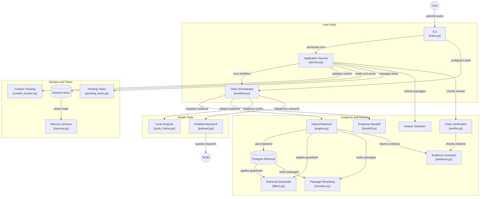

# Women's Health AI Agent 🌸

[](https://www.python.org/)
[](https://github.com/pgvector/pgvector)
[](https://redis.io/)
[](tests/)
[](evals/)

An **evidence-grounded, non-diagnostic clinical education assistant** for adult menstrual health and Polycystic Ovary Syndrome (PCOS). Built with strict medical safety guardrails, verified public-health evidence, zero-hallucination citation checks, and ephemeral privacy-first memory.

---

## 🌟 What Is It? (In Simple Words)

Most AI chatbots answer health questions by "predicting" the next words, which frequently leads to **hallucinations, false confidence, or dangerous medical errors**.

The **Women's Health AI Agent** takes a fundamentally different, clinically governed approach:
* **Zero Guesswork:** It never invents medical facts. It answers exclusively using word-for-word, versioned excerpts from accredited health authorities (World Health Organization, ACOG, CDC, and NIH).
* **Automatic Fact Inspection:** Every sentence generated is checked against source citations using an automated claim verifier (`ClaimVerifier`) before it is displayed. If a statement cannot be verified 100%, the agent safely abstains.
* **Privacy by Default:** Your health conversations are strictly private. The agent uses temporary memory that automatically expires and erases itself, with instant data deletion on command.

---

## 💬 What Questions Does It Answer?

The assistant is validated to provide educational guidance across four primary pillars:

1. **Polycystic Ovary Syndrome (PCOS):**
   * Clear explanations of what PCOS is and how it affects reproductive hormones.
   * Commonly recognized symptoms (irregular cycles, hirsutism, persistent acne, insulin resistance).
   * Evidence-based lifestyle habits, physical activity, and dietary patterns for symptom support.

2. **Menstrual Health & Cycle Variations:**
   * Normal menstrual physiology, phases, and expected cycle ranges (21 to 35 days).
   * Painful periods and menstrual cramps (**Dysmenorrhea**): causes, non-pharmacological comfort measures, and when to seek medical evaluation.
   * Heavy menstrual bleeding (**Menorrhagia**): definitions, warning signs, and iron nutrition support.

3. **Menstrual Cycle Interval Arithmetic (Calculator Tool):**
   * Calculates exact intervals, average cycle length, and variation between consecutive period start dates supplied by the user.

4. **Scientific Research (PubMed Explorer):**
   * Searches the official NCBI PubMed repository for peer-reviewed studies when scientific literature is explicitly requested.

---

## 🛡️ What Does It NOT Do? (Safety Guardrails)

To protect patient safety and comply with medical device guidelines, the agent strictly enforces pre-retrieval safety boundaries:

* ❌ **No Individual Medical Diagnoses:** The agent educates; it does not replace a doctor.
* ❌ **No Medication Prescriptions or Dosing Adjustments:** Requests to start, stop, or change doses of prescription drugs (Metformin, Spironolactone, Birth Control, etc.) are strictly blocked and referred to a prescribing clinician or pharmacist.
* ❌ **No Emergency Contraception Prescribing:** Queries regarding emergency contraceptive pills (e.g., *i-pill*, *Plan B*, *levonorgestrel*) are safely declared outside the educational corpus.
* ❌ **Immediate Emergency Escalation:** Red-flag symptoms (such as soaking through $\ge$ 2 pads an hour, sudden fainting, severe acute pelvic pain, or pregnancy complications) immediately trigger emergency triage guidance, bypassing all tools and retrieval.
* ❌ **Adults Only (18+):** Adolescent physiology differs significantly; questions from users under 18 are automatically routed to pediatric care.

---

## 🏛️ System Architecture Diagram

The system connects user interactions, safety filters, database adapters, and fact verification in a clean, self-healing pipeline:



---

## ⚡ Key Technical Innovations

1. **Dual Trust-Domain Isolation:**
   * **Ephemeral Patient Memory:** Conversation state is maintained in Redis with native TTL expiration (default 30 min) and TriState context (`yes`, `no`, `not_provided`).
   * **Governed Clinical Registry:** Stored in PostgreSQL with `pgvector` and mirrored locally in `manifest.json`. Sources are stamped with cryptographic SHA-256 fingerprints.

2. **PostgreSQL + pgvector Hybrid Search:**
   * Blends native full-text search (`ts_rank_cd`) with vector cosine similarity (`<=>`), filtered by strict relevance thresholding (`0.18`), jurisdiction, population, and expiry rules.
   * Punctuation-safe token grammar protects against SQL injection or full-text syntax crashes.

3. **Automated Claim Verification Gate:**
   * Candidate responses are inspected by `ClaimVerifier`. Any answer with unsupported statements or citation mismatches is replaced with a safe abstention fallback.

4. **Self-Healing Infrastructure:**
   * Auto-detecting factories (`get_session_store` and `get_retrieval_engine`) automatically connect to live PostgreSQL and Redis services when running, and gracefully fall back to local in-memory engines when offline without downtime.

---

## 🚀 Quick Start Guide

### 1. Prerequisites & Environment Setup
Clone the repository and activate the virtual environment:

```powershell
# In PowerShell (Windows)
.\venv\Scripts\Activate.ps1
```

*(Or use `.\venv\Scripts\python.exe` directly)*.

### 2. Run the Interactive Assistant
Start the interactive conversational CLI with memory enabled:
```powershell
python main.py --remember
```
* Commands available in interactive chat:
  * `/forget`: Wipes your conversation context immediately.
  * `/cancel`: Clears any pending date calculation.
  * `/quit`: Cleanly exits the assistant.

### 3. Ask Specific Questions via Terminal
```powershell
# Medical evidence inquiry
python main.py --query "What is PCOS and what are its symptoms?"

# Emergency red-flag safety check
python main.py --query "I am pregnant, bleeding heavily and about to faint"

# Calculate cycle intervals
python main.py --query "Calculate my cycle intervals" --period-starts 2026-08-01 2026-09-05 2026-10-08 --as-of 2026-11-06

# Structured JSON output (API integration mode)
python main.py --query "What is PCOS?" --json
```

---

## 🧪 Testing & Quality Assurance

The codebase includes an exhaustive automated test suite and a 50-scenario clinical evaluation benchmark:

```powershell
# Run all 149 unit and integration tests
python -m unittest discover -s tests -v

# Run the 50-case Section 10 Clinical Release Gate Benchmark
python -m evals.run_evals
```

### Release Gates Performance
| Quality Gate | Target | Current Score | Status |
| :--- | :---: | :---: | :---: |
| **Immediate Danger Sensitivity** | 100.0% | **100.0%** | ✅ PASS |
| **Medication & Policy Guardrails** | 100.0% | **100.0%** | ✅ PASS |
| **Minor (Under 18) Scope Routing** | 100.0% | **100.0%** | ✅ PASS |
| **Approved Citation Validity** | 100.0% | **100.0%** | ✅ PASS |
| **In-Scope Educational Quality** | $\ge$ 95.0% | **100.0%** | ✅ PASS |

---

## 📂 Repository Structure

```text
├── app/
│   ├── retrieval/             # Hybrid search, PostgreSQL pgvector engine, filters, reranker
│   ├── schemas/               # Canonical Pydantic models (evidence, citations, session memory)
│   ├── storage/               # Redis session store, in-memory store, TriState context tracker
│   ├── verification/          # ClaimVerifier & citation integrity validation
│   └── workflow/              # HealthApplication service & task stores
├── clinical/
│   └── evidence_manifest/     # Versioned clinical evidence manifest (manifest.json)
├── docs/                      # Engineering contracts, orchestration guide, consistency specs
├── evals/                     # 50-case seed benchmark suite & scoring rubrics
├── health_tools/              # Cycle history arithmetic, PubMed search, focused answer selection
├── infra/                     # Docker Compose file for PostgreSQL + pgvector and Redis
├── pipelines/                 # Manifest synchronization and database migration tools
├── tests/                     # 149 unit, integration, and live database test suites
├── main.py                    # Main application CLI entry point
├── tools.py                   # Guardrailed educational search tools
└── REQUIREMENTS.txt           # Project dependencies
```

---

## ⚠️ Clinical Disclaimer

> **Important:** This assistant provides general educational information on menstrual health and PCOS for adults (18+) and cannot establish an individual medical diagnosis, interpret personal laboratory results, or direct medication changes. Software test results do not establish medical accuracy or clinical approval. Always consult a qualified healthcare professional for persistent, severe, or concerning symptoms.
